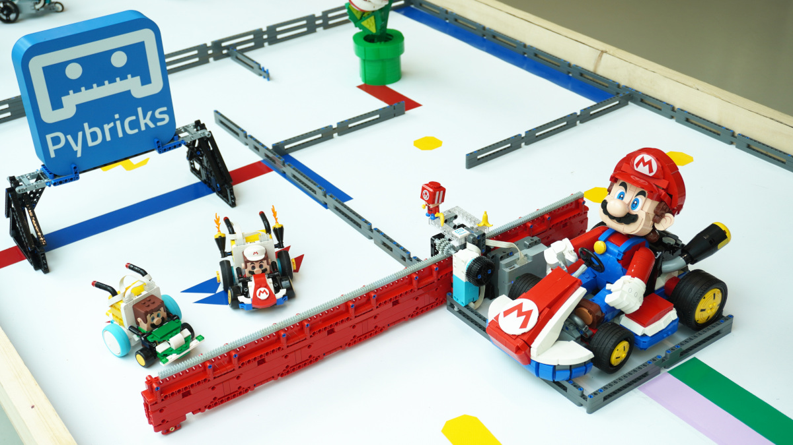

# LEGO® Mario Kart

Watch the [video here][0].

# How does it work?

[Pybricks][1] can run on any re-programmable LEGO hub.

A hub running Pybricks can also connect to another LEGO hub with stock firmware using the [LEGO Wireless Protocol V3 (LWP3)][2]. This includes the LEGO Mario hubs. This lets the hub running Pybricks read the RGB color values measured by Mario.

# Instructions

- Build a kart with SPIKE Essential with two motors.
- Build a track with color markers and obstacles.
- [Install the latest Pybricks firmware][3] on the SPIKE Essential Hub.
- Run `mario.py` on the SPIKE Essential Hub.
- Turn on the train remote.
- Turn on Mario and press the Bluetooth button to enter connect mode.
- Play!

# Device names
This example connects to a specific Mario hub and Train remote using their
Bluetooth name. This is practical if you have more than one set. If you have
only one, you can just delete the name filters from the example.

[0]: https://www.youtube.com/watch?v=A0NyhdayHJs
[1]: https://pybricks.com/
[2]: https://lego.github.io/lego-ble-wireless-protocol-docs/

-------

LEGO® is a trademark of the LEGO Group of companies which does not sponsor, authorize or endorse this site. Nintendo doesn't, either.

